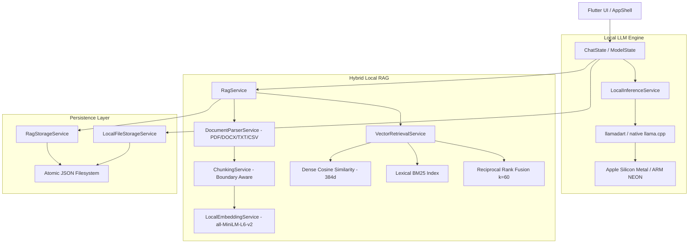

<div align="center">

<p align="center">
  
</p>

# 🧠 Sovereign AI
### *100% Offline, Private, Cross-Platform On-Device AI with Neural RAG & Local GGUF Inference*

<p align="center">
  <a href="#-quick-download-v100"></a>
  <a href="https://flutter.dev"></a>
  <a href="https://dart.dev"></a>
  <a href="#-privacy--security-guarantees"></a>
  <a href="LICENSE"></a>
</p>

---

## ⚡ Instant Downloads (v1.0.0 Production Releases)

Choose your platform below to download the pre-compiled, production-ready app:

<p align="center">
  <a href="https://github.com/sdmazaharmehadi7/local_ai_flutter/releases/download/v1.0.0/app-release.apk">
    
  </a>
  &nbsp;&nbsp;
  <a href="https://github.com/sdmazaharmehadi7/local_ai_flutter/releases/download/v1.0.0/SovereignAI-1.0.0-macos.zip">
    
  </a>
  &nbsp;&nbsp;
  <a href="https://github.com/sdmazaharmehadi7/local_ai_flutter/releases/download/v1.0.0/SovereignAI-Windows-x64.zip">
    
  </a>
  &nbsp;&nbsp;
  <a href="https://github.com/sdmazaharmehadi7/local_ai_flutter/releases/download/v1.0.0/SovereignAI-Linux-x64.zip">
    
  </a>
</p>

| Operating System | Package Format | Architecture | Direct Download Link |
| :--- | :---: | :---: | :--- |
| **🤖 Android** | `.apk` (Standalone) | `arm64-v8a` (Android 7.0+) | [📥 **Download `app-release.apk`**](https://github.com/sdmazaharmehadi7/local_ai_flutter/releases/download/v1.0.0/app-release.apk) |
| **🍏 macOS** | `.zip` (Universal `.app`) | Apple Silicon (M1-M4) & Intel | [📥 **Download `SovereignAI-1.0.0-macos.zip`**](https://github.com/sdmazaharmehadi7/local_ai_flutter/releases/download/v1.0.0/sovereign_ai-macos.zip) |
| **🪟 Windows** | `.zip` (Portable `.exe` + DLLs) | 64-bit `x86_64` (Win 10/11) | [📥 **Download `SovereignAI-Windows-x64.zip`**](https://github.com/sdmazaharmehadi7/local_ai_flutter/releases/download/v1.0.0/SovereignAI-Windows-x64.zip) |
| **🐧 Linux** | `.zip` (Portable Bundle) | 64-bit `x86_64` (Ubuntu / Debian / Fedora) | [📥 **Download `SovereignAI-Linux-x64.zip`**](https://github.com/sdmazaharmehadi7/local_ai_flutter/releases/download/v1.0.0/SovereignAI-Linux-x64.zip) |

---


# Sovereign AI for macOS — Installation Guide

macOS may display a warning saying Apple cannot verify that `sovereign_ai.app` is free of malware. This can happen because the app is not yet signed and notarized by Apple.

**If you downloaded the app from the official Sovereign AI GitHub repository and trust the download, follow these steps:**

1. Download and extract the macOS ZIP file.
2. Move `sovereign_ai.app` to your Applications folder.
3. Try opening the app. If macOS blocks it, open **System Settings → Privacy & Security**.
4. Scroll to the Security section and select **Open Anyway** for `sovereign_ai.app`, if that option appears.
5. Confirm your choice when prompted, then open the app again.

**Security note:** Only bypass this warning if you trust the source and have verified the download. This warning does not prove that the app is malicious, but it also does not guarantee that the app is safe.

Apple signing and notarization support is planned for a future release.

</div>

## 📖 Overview

**Sovereign AI** gives you sovereign, air-gapped personal artificial intelligence. By utilizing native C++ bindings to `llama.cpp` through `llamadart`, it executes quantized GGUF chat models and neural embedding models entirely in local device memory—leveraging **Metal** on Apple Silicon, **ARM NEON** on mobile, and **AVX2** on Desktop.

### 🚫 What Sovereign AI NEVER does:
- ❌ **No Cloud Inference**: Never transmits your prompts, documents, or responses to OpenAI, Anthropic, or external servers.
- ❌ **No External Daemons**: No Docker containers or background Ollama processes needed.
- ❌ **No Telemetry**: Absolutely zero usage analytics, tracking, or fingerprinting.

---

## ✨ Key Features

```
┌────────────────────────────────────────────────────────────────────────┐
│  🧠 Local GGUF Engine       🔍 Hybrid Neural RAG    📄 Document Chat   │
│  Native llama.cpp execution  Dense vectors + BM25    PDF, DOCX, TXT,   │
│  via Metal & ARM NEON        Reciprocal Rank Fusion  CSV, JSON, LOG    │
│                                                                        │
│  📦 Model Manager           🛡️ Atomic Storage       🎨 Modern UI       │
│  In-app GGUF downloads       Serialized JSON queues  ChatGPT aesthetic │
│  & custom file imports       Zero SQLite / Hive      Dark / Light Mode │
└────────────────────────────────────────────────────────────────────────┘
```

- **⚡ Local GGUF LLM Inference**: Direct native bindings to `llama.cpp` via `llamadart`. Stream tokens smoothly on-device with zero network latency.
- **🔍 Hybrid Neural RAG (Dense + BM25)**:
  - **Dense Embeddings**: Local 384-dimensional vector inference using `all-MiniLM-L6-v2-Q4_K_M.gguf` (~23 MB).
  - **Lexical BM25**: Full-text term frequency & inverse document frequency search for exact keyword, part number, and error code matching.
  - **Reciprocal Rank Fusion (RRF)**: Merges semantic and lexical scores ($k=60$) for optimal retrieval quality.
  - **Automatic Fallback**: Transparently falls back to BM25 if the embedding model is not yet installed.
- **📄 Multi-Format Document Ingestion**: Upload and chat with **PDF, TXT, Markdown, CSV, JSON, LOG, and DOCX** files. Preserves page numbers and section headings for verifiable citations.
- **🎯 Precise Citation Engine**: Displays interactive citation pills linking directly to original excerpts with page references.
- **📦 In-App Model Manager**:
  - Direct downloads from Hugging Face with pause/resume, speed indicators, and header validation.
  - One-tap import of custom `.gguf` files from your local storage.
  - Clean model deletion and disk quota management.
- **🛡️ Atomic JSON Storage**: Robust file-based persistence with serialized write queues and atomic rename operations. No SQLite, no Hive, no cloud database.
- **🎨 Modern ChatGPT-Style Interface**: Responsive sidebar navigation drawer, dark/light theme switching, model parameter controls (temperature, top-p, context window), and smooth micro-animations.

---

## 🏗 System Architecture



---

## 💻 Prerequisites & System Requirements

Ensure the following tools are installed on your workstation if building from source:

| Tool | Minimum Version | Recommended |
| :--- | :--- | :--- |
| **Flutter SDK** | `>= 3.24.0` | `3.47.7` (Stable) |
| **Dart SDK** | `>= 3.5.0` | `3.13.5` |
| **Git** | `>= 2.30.0` | Latest |
| **Xcode** *(for macOS / iOS)* | `15.0+` | `15.4+` with Command Line Tools |
| **Android Studio / SDK** *(for Android)* | API 24+ (Android 7.0+) | Android SDK 34+, NDK installed |
| **CocoaPods** *(for iOS/macOS)* | `>= 1.14.0` | Latest |
| **Visual Studio** *(for Windows)* | 2022 | Desktop C++ Workload + Windows SDK |
| **Clang / CMake / GTK3** *(for Linux)* | CMake 3.10+ | `sudo apt install clang cmake ninja-build libgtk-3-dev` |

---

## 🚀 Clone and Setup (Developers)

### 1. Clone the Repository
```bash
git clone https://github.com/sdmazaharmehadi7/local_ai_flutter.git
cd local_ai_flutter
```

### 2. Verify Your Flutter Environment
```bash
flutter doctor -v
```

### 3. Install Dependencies
```bash
flutter pub get
```

### 4. Verify Static Analysis and Test Suite
```bash
flutter analyze
flutter test
```
*All 65 automated tests should pass with zero warnings.*

---

## 📱 Running the App Locally

### 1. macOS Desktop
```bash
flutter config --enable-macos-desktop
flutter run -d macos
```

### 2. Android
Connect your Android phone via USB with USB Debugging enabled:
```bash
flutter run -d <device_id>
```

### 3. iOS Simulator
```bash
flutter run -d ios
```

### 4. Windows Desktop
```bash
flutter config --enable-windows-desktop
flutter run -d windows
```

### 5. Linux Desktop
```bash
flutter config --enable-linux-desktop
flutter run -d linux
```

---

## 🤖 Model Management & Curated Catalog

Sovereign AI operates completely offline by utilizing GGUF format weights. Open the **Model Manager** tab in the app to download curated models or import files from your device:

| Model Name | Size | Architecture | Best Use Case |
| :--- | :---: | :---: | :--- |
| **all-MiniLM-L6-v2 (Embedding)** | **23 MB** | MiniLM (384-d) | **Required for Local Neural RAG**. Fast on-device semantic vector retrieval. |
| **SmolLM2 135M Instruct** | **90 MB** | SmolLM | Ultra-compact test model for low-memory mobile verification. |
| **Qwen 2.5 0.5B Instruct** | **390 MB** | Qwen | Fast, low memory footprint, multilingual. |
| **Llama 3.2 1B Instruct** | **800 MB** | Llama | High quality mobile-friendly reasoning and chat. |
| **Qwen 2.5 1.5B Instruct** | **1.1 GB** | Qwen | Excellent instruction following, code generation, and reasoning. |
| **Gemma 2 2B IT Abliterated** | **1.6 GB** | Gemma | Uncensored local model with refusal mechanisms neutralized. |
| **Llama 3.2 3B Instruct** | **2.0 GB** | Llama | Desktop & flagship phone model for complex analytical tasks. |

---

## 📚 Document Ingestion & Local Neural RAG

To chat with private documents:
1. Tap the **Paperclip icon** in the chat bar.
2. Select one or more documents (**PDF, DOCX, TXT, Markdown, CSV, JSON, LOG**).
3. The app parses text, preserves page metadata, performs boundary-aware chunking, and indexes dense vectors via `all-MiniLM-L6-v2`.
4. Ask any question. The hybrid retrieval engine scores passages using Reciprocal Rank Fusion:
   $$RRF(d) = \frac{0.6}{60 + r_{\text{dense}}(d)} + \frac{0.4}{60 + r_{\text{lexical}}(d)}$$
5. The retrieved evidence is injected into the local LLM context with strict grounding constraints.
6. Answers include interactive **Citation Pills** (`[filename, Page X]`). Tap any citation pill to view the source passage.

---

## 🧪 Automated Testing & Benchmark Suite

```bash
# Run code analysis
flutter analyze

# Run all 65 unit and benchmark tests
flutter test

# Run RAG neural benchmark test specifically
flutter test test/rag_neural_benchmark_test.dart
```

---

## 📦 Building Production Releases

```bash
# macOS Universal App (.app)
flutter build macos --release

# Android ARM64 APK (.apk)
flutter build apk --release --target-platform android-arm64

# iOS Release (.ipa payload)
flutter build ios --release --no-codesign

# Windows Desktop (.exe + DLLs)
flutter build windows --release

# Linux Desktop (Bundle)
flutter build linux --release
```

---

## 📂 Project Directory Structure

```text
sovereign_ai/
├── media/                     # Project banners and visual assets
├── .github/workflows/         # Automated release workflows (Windows, Linux, iOS)
├── android/                   # Android native platform files (ARM64 / Gradle)
├── ios/                       # iOS native platform files (Xcode / SPM / iOS 16.4+)
├── macos/                     # macOS native platform files (Metal / App Sandbox)
├── windows/                   # Windows C++ Desktop runner
├── linux/                     # Linux GTK Desktop runner
├── lib/
│   ├── core/                  # Design tokens, theme, typography, constants
│   ├── models/                # Data models
│   │   ├── chat_message.dart  # Message role, status, citations
│   │   ├── chat_session.dart  # Session persistence model
│   │   ├── local_model.dart   # GGUF & Embedding catalog model
│   │   └── rag/               # DocumentChunk (schema v2), DocumentAttachment, RagCitation
│   ├── services/              # Core business services
│   │   ├── inference_service.dart     # llamadart GGUF engine wrapper
│   │   ├── model_download_service.dart # Streaming download & GGUF header validation
│   │   ├── storage_service.dart       # Atomic JSON conversation persistence
│   │   └── rag/                       # Local RAG engine
│   │       ├── document_parser_service.dart # PDF, DOCX, TXT, CSV, JSON parsers
│   │       ├── chunking_service.dart       # Boundary-aware token/word chunker
│   │       ├── embedding_service.dart      # Local neural embedding service (MiniLM-L6-v2)
│   │       ├── vector_retrieval_service.dart # Dense cosine + BM25 + RRF fusion
│   │       ├── rag_storage_service.dart    # Atomic JSON vector index storage
│   │       └── rag_service.dart            # Unified RAG coordinator
│   ├── state/                 # State management (ChatState, ModelState, SettingsState)
│   ├── ui/                    # Redesigned ChatGPT-inspired UI
│   │   ├── chat/              # Chat view, message bubbles, citation pills, input bar
│   │   ├── models/            # Model catalog cards, downloads, import dialogs
│   │   ├── settings/          # Generation hyperparameters, theme selection
│   │   └── shell/             # Navigation drawer and responsive shell
│   └── main.dart              # Dependency injection & application entry point
├── test/                      # 65 Unit, integration & benchmark tests
└── RELEASES.md                # Release artifacts manifest and verification hashes
```

---

## 🔒 Privacy & Security Guarantees

1. **Zero External Inference**: Every token generated and every vector embedded occurs exclusively in your device's memory and CPU/GPU.
2. **Zero Telemetry**: No tracking, analytics, or behavioral logging.
3. **No Hidden Daemons**: No background Docker instances, Ollama daemons, or open local web server ports.
4. **Local Document Security**: Document files remain in your local app storage directory and are never uploaded or synced to external cloud services.
5. **Untrusted Prompt Isolation**: Retrieved document text is treated strictly as passive context data and wrapped in boundary separators to prevent prompt injection attacks.

---

## 📄 License

This project is licensed under the **Apache License 2.0**. See the [LICENSE](LICENSE) file for details.

---

<div align="center">
  <b>Built with ❤️ for privacy, autonomy, and sovereign AI compute.</b>
</div>
