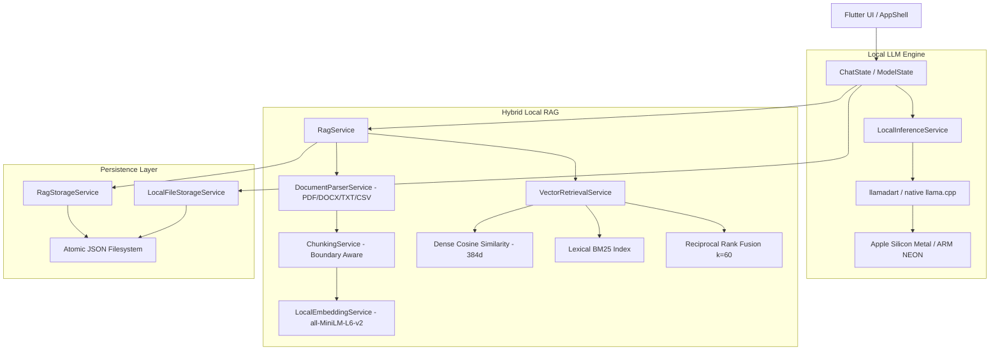

<div align="center">

# 🧠 Sovereign AI

### *100% Offline, Private, Cross-Platform On-Device AI with Neural RAG & Local GGUF Inference*

[](https://flutter.dev)
[](https://dart.dev)
[](#cross-platform-support)
[](https://github.com/ggerganov/llama.cpp)
[-green)](https://huggingface.co/sentence-transformers/all-MiniLM-L6-v2)
[](#privacy--security-guarantees)
[](LICENSE)

---

**Sovereign AI** is a production-grade, offline-first personal AI assistant built with Flutter. It runs large language models (LLMs) and neural embeddings directly on your device's hardware using Metal (Apple Silicon), ARM NEON (Android/iOS), and AVX2 (Desktop x86_64).

**No cloud APIs. No Ollama daemon. No external server. Pure local compute.**

</div>

---

## 📑 Table of Contents

- [Key Features](#-key-features)
- [System Architecture](#-system-architecture)
- [Prerequisites & System Requirements](#-prerequisites--system-requirements)
- [Clone and Setup](#-clone-and-setup)
- [Running the App](#-running-the-app)
  - [macOS Desktop](#1-macos-desktop)
  - [Android](#2-android)
  - [iOS](#3-ios)
  - [Windows & Linux](#4-windows--linux)
- [Model Management & Recommended Models](#-model-management--recommended-models)
- [Document Ingestion & Local Neural RAG](#-document-ingestion--local-neural-rag)
- [Automated Testing & Static Analysis](#-automated-testing--static-analysis)
- [Building Production Releases](#-building-production-releases)
- [CI/CD Workflows](#-cicd-workflows)
- [Project Directory Structure](#-project-directory-structure)
- [Privacy & Security Guarantees](#-privacy--security-guarantees)
- [License](#-license)

---

## ✨ Key Features

- **⚡ Local GGUF LLM Inference**: Direct native bindings to `llama.cpp` via `llamadart`. Stream tokens smoothly on-device with zero network latency.
- **🔍 Hybrid Neural RAG (Dense + BM25)**:
  - **Dense Embeddings**: Local 384-dimensional vector inference using `all-MiniLM-L6-v2-Q4_K_M.gguf` (~23 MB).
  - **Lexical BM25**: Full-text term frequency & inverse document frequency search for exact keyword, part number, and error code matching.
  - **Reciprocal Rank Fusion (RRF)**: Merges semantic and lexical scores ($k=60$) for optimal retrieval quality.
  - **Automatic Fallback**: Transparently falls back to BM25 if the embedding model is not yet installed.
- **📄 Multi-Format Document Ingestion**: Upload and chat with **PDF, TXT, Markdown, CSV, JSON, LOG, and DOCX** files. Preserves page numbers and section headings for verifiable citations.
- **🎯 Precise Citation Engine**: Displays interactive citation pills linking directly to original excerpts with page references.
- **📦 In-App Model Manager**:
  - Direct downloads from Hugging Face with pause/resume, speed indicators, and header validation.
  - One-tap import of custom `.gguf` files from your local storage.
  - Clean model deletion and disk quota management.
- **🛡️ Atomic JSON Storage**: Robust file-based persistence with serialized write queues and atomic rename operations. No SQLite, no Hive, no cloud database.
- **🎨 Modern ChatGPT-Style Interface**: Responsive sidebar navigation drawer, dark/light theme switching, model parameter controls (temperature, top-p, context window), and smooth micro-animations.

---

## 🏗 System Architecture



---

## 💻 Prerequisites & System Requirements

Ensure the following tools are installed on your workstation:

| Tool | Minimum Version | Recommended |
| :--- | :--- | :--- |
| **Flutter SDK** | `>= 3.24.0` | `3.47.7` (Stable) |
| **Dart SDK** | `>= 3.5.0` | `3.13.5` |
| **Git** | `>= 2.30.0` | Latest |
| **Xcode** *(for macOS / iOS)* | `15.0+` | `15.4+` with Command Line Tools |
| **Android Studio / SDK** *(for Android)* | API 24+ (Android 7.0+) | Android SDK 34+, NDK installed |
| **CocoaPods** *(for iOS/macOS)* | `>= 1.14.0` | Latest |
| **Visual Studio** *(for Windows)* | 2022 | Desktop C++ Workload + Windows SDK |
| **Clang / CMake / GTK3** *(for Linux)* | CMake 3.10+ | `sudo apt install clang cmake ninja-build libgtk-3-dev` |

---

## 🚀 Clone and Setup

### 1. Clone the Repository
```bash
git clone https://github.com/sdmazaharmehadi7/local_ai_flutter.git
cd local_ai_flutter
```

### 2. Verify Your Flutter Environment
```bash
flutter doctor -v
```
*Ensure that Flutter, Dart, and your target platform tools (Xcode or Android toolchain) have green checkmarks.*

### 3. Install Dependencies
```bash
flutter pub get
```

### 4. Verify Static Analysis and Test Suite
```bash
flutter analyze
flutter test
```
*All 65 automated tests should pass with zero warnings.*

---

## 📱 Running the App

### 1. macOS Desktop
Ensure macOS desktop support is enabled:
```bash
flutter config --enable-macos-desktop
flutter run -d macos
```

### 2. Android
Connect your Android device via USB (or start an Android Emulator with ABI `arm64-v8a` or `x86_64`):
```bash
flutter devices
flutter run -d <device_id>
```

### 3. iOS
Open the iOS Simulator or connect a physical iPhone:
```bash
flutter run -d ios
```
*Note: Physical iOS devices require configuring your Apple Developer Team in `ios/Runner.xcworkspace`.*

### 4. Windows & Linux
Enable desktop support on your respective host OS:
```bash
# On Windows:
flutter config --enable-windows-desktop
flutter run -d windows

# On Linux:
flutter config --enable-linux-desktop
flutter run -d linux
```

---

## 🤖 Model Management & Recommended Models

Sovereign AI operates completely offline by utilizing GGUF format weights. Open the **Model Manager** tab in the app to download curated models or import files from your device:

| Model Name | Size | Architecture | Best Use Case |
| :--- | :---: | :---: | :--- |
| **all-MiniLM-L6-v2 (Embedding)** | **23 MB** | MiniLM (384-d) | **Required for Local Neural RAG**. Fast on-device semantic vector retrieval. |
| **SmolLM2 135M Instruct** | **90 MB** | SmolLM | Ultra-compact test model for low-memory mobile verification. |
| **Qwen 2.5 0.5B Instruct** | **390 MB** | Qwen | Fast, low memory footprint, multilingual. |
| **Llama 3.2 1B Instruct** | **800 MB** | Llama | High quality mobile-friendly reasoning and chat. |
| **Qwen 2.5 1.5B Instruct** | **1.1 GB** | Qwen | Excellent instruction following, code generation, and reasoning. |
| **Gemma 2 2B IT Abliterated** | **1.6 GB** | Gemma | Uncensored local model with refusal mechanisms neutralized. |
| **Llama 3.2 3B Instruct** | **2.0 GB** | Llama | Desktop & flagship phone model for complex analytical tasks. |

> **Note:** Models are stored securely in the app's document directory (`~/sovereign_ai/models`). You can also import any custom `.gguf` file downloaded from Hugging Face.

---

## 📚 Document Ingestion & Local Neural RAG

To chat with private documents:
1. Tap the **Paperclip icon** in the chat bar.
2. Select one or more documents (**PDF, DOCX, TXT, Markdown, CSV, JSON, LOG**).
3. The app parses text, preserves page metadata, performs boundary-aware chunking, and indexes dense vectors via `all-MiniLM-L6-v2`.
4. Ask any question. The hybrid retrieval engine scores passages using Reciprocal Rank Fusion:
   $$RRF(d) = \frac{0.6}{60 + r_{\text{dense}}(d)} + \frac{0.4}{60 + r_{\text{lexical}}(d)}$$
5. The retrieved evidence is injected into the local LLM context with strict grounding constraints.
6. Answers include interactive **Citation Pills** (`[filename, Page X]`). Tap any citation pill to view the source passage.

---

## 🧪 Automated Testing & Static Analysis

The project includes unit, integration, and benchmark tests covering the inference runtime, RAG parser, vector indexing, and UI state:

```bash
# Run code analysis
flutter analyze

# Run all 65 unit and benchmark tests
flutter test

# Run RAG neural benchmark test specifically
flutter test test/rag_neural_benchmark_test.dart
```

### Benchmark Metrics Verified:
- **L2 Vector Normalization**: Unit vectors satisfy $\|v\| = 1.0 \pm 10^{-5}$.
- **Paraphrased Queries**: Neural cosine search retrieves relevant passages where lexical BM25 scores 0.
- **Exact Identifiers**: BM25 and Hybrid guarantee 100% precision for error codes (e.g. `ERR-9940-KERNEL`) and part numbers.
- **Model Fallback**: Graceful degradation to BM25 when embeddings are unavailable.

---

## 📦 Building Production Releases

### 1. macOS Universal App (.app & .zip)
```bash
flutter build macos --release
```
- **Output:** `build/macos/Build/Products/Release/sovereign_ai.app` (82.2 MB)
- Package into distributable archive:
  ```bash
  cd build/macos/Build/Products/Release
  zip -r SovereignAI-1.0.0-macos.zip sovereign_ai.app
  ```

### 2. Android ARM64 Release APK
```bash
flutter build apk --release --target-platform android-arm64
```
- **Output:** `build/app/outputs/flutter-apk/app-release.apk` (128.7 MB)

### 3. iOS Package (.ipa)
```bash
# Build unsigned release payload (no certificates required)
flutter build ios --release --no-codesign

# Package into .ipa
mkdir -p build/ios/ipa/Payload
cp -R build/ios/iphoneos/Runner.app build/ios/ipa/Payload/
cd build/ios/ipa && zip -r SovereignAI-1.0.0-ios-unsigned.ipa Payload
```

### 4. Windows Desktop Release
```bash
flutter build windows --release
```
- **Output:** `build/windows/x64/runner/Release/`

### 5. Linux Desktop Release
```bash
flutter build linux --release
```
- **Output:** `build/linux/x64/release/bundle/`

---

## ⚙️ CI/CD Workflows

Continuous Integration and Release packaging are automated with GitHub Actions:

- [`.github/workflows/release-windows.yml`](.github/workflows/release-windows.yml): Builds on `windows-latest`, compiles C++ Win32 runner, packages `SovereignAI-1.0.0-windows-x64.zip`, and generates SHA-256 hashes.
- [`.github/workflows/release-linux.yml`](.github/workflows/release-linux.yml): Builds on `ubuntu-latest` with GTK3/Ninja, creates `SovereignAI-1.0.0-linux-x64.tar.gz`, and generates SHA-256 hashes.
- [`.github/workflows/release-ios.yml`](.github/workflows/release-ios.yml): Builds on `macos-14`, signs with repository secrets (or packages unsigned IPA for TestFlight/AltStore).

---

## 📂 Project Directory Structure

```text
sovereign_ai/
├── .github/workflows/         # CI/CD Workflows (Windows, Linux, iOS)
├── android/                   # Android native platform files (ARM64 / Gradle)
├── ios/                       # iOS native platform files (Xcode / SPM / iOS 16.4+)
├── macos/                     # macOS native platform files (Metal / App Sandbox)
├── windows/                   # Windows C++ Desktop runner
├── linux/                     # Linux GTK Desktop runner
├── lib/
│   ├── core/                  # Design tokens, theme, typography, constants
│   ├── models/                # Data models
│   │   ├── chat_message.dart  # Message role, status, citations
│   │   ├── chat_session.dart  # Session persistence model
│   │   ├── local_model.dart   # GGUF & Embedding catalog model
│   │   └── rag/               # DocumentChunk (schema v2), DocumentAttachment, RagCitation
│   ├── services/              # Core business services
│   │   ├── inference_service.dart     # llamadart GGUF engine wrapper
│   │   ├── model_download_service.dart # Streaming download & GGUF header validation
│   │   ├── storage_service.dart       # Atomic JSON conversation persistence
│   │   └── rag/                       # Local RAG engine
│   │       ├── document_parser_service.dart # PDF, DOCX, TXT, CSV, JSON parsers
│   │       ├── chunking_service.dart       # Boundary-aware token/word chunker
│   │       ├── embedding_service.dart      # Local neural embedding service (MiniLM-L6-v2)
│   │       ├── vector_retrieval_service.dart # Dense cosine + BM25 + RRF fusion
│   │       ├── rag_storage_service.dart    # Atomic JSON vector index storage
│   │       └── rag_service.dart            # Unified RAG coordinator
│   ├── state/                 # State management (ChatState, ModelState, SettingsState)
│   ├── ui/                    # Redesigned ChatGPT-inspired UI
│   │   ├── chat/              # Chat view, message bubbles, citation pills, input bar
│   │   ├── models/            # Model catalog cards, downloads, import dialogs
│   │   ├── settings/          # Generation hyperparameters, theme selection
│   │   └── shell/             # Navigation drawer and responsive shell
│   └── main.dart              # Dependency injection & application entry point
├── test/                      # 65 Unit, integration & benchmark tests
├── pubspec.yaml               # Project dependencies and asset declarations
└── RELEASES.md                # Release artifacts manifest and verification hashes
```

---

## 🔒 Privacy & Security Guarantees

1. **Zero External Inference**: Every token generated and every vector embedded occurs exclusively in your device's memory and CPU/GPU.
2. **Zero Telemetry**: No tracking, analytics, or behavioral logging.
3. **No Hidden Daemons**: No background Docker instances, Ollama daemons, or open local web server ports.
4. **Local Document Security**: Document files remain in your local app storage directory and are never uploaded or synced to external cloud services.
5. **Untrusted Prompt Isolation**: Retrieved document text is treated strictly as passive context data and wrapped in boundary separators to prevent prompt injection attacks.

---

## 📄 License

This project is licensed under the **Apache License 2.0**. See the [LICENSE](LICENSE) file for details.

---

<div align="center">
  <b>Built with ❤️ for privacy, autonomy, and sovereign AI compute.</b>
</div>
